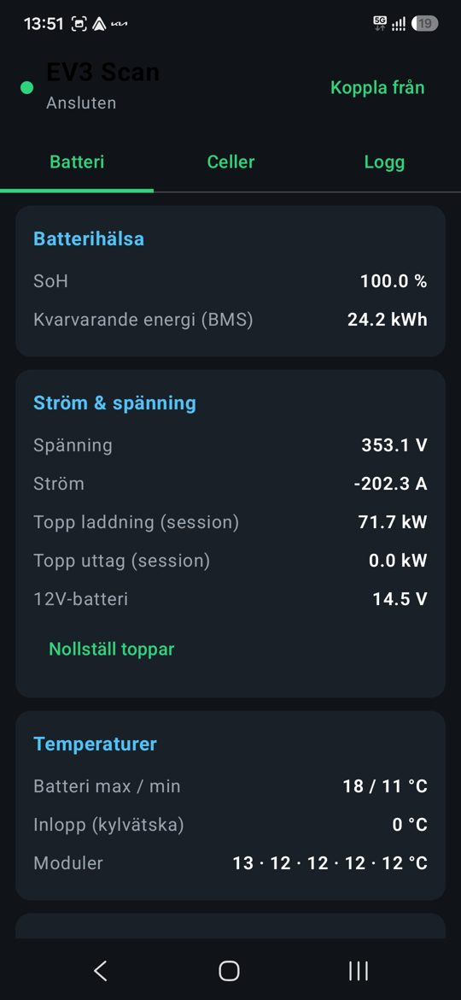
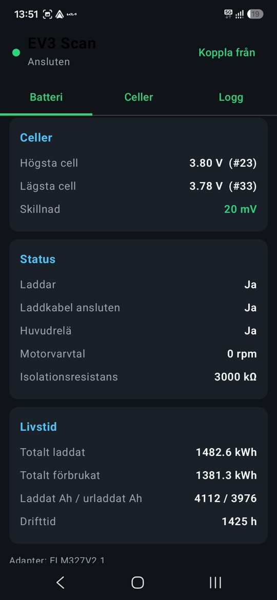

# EV3 Scan

Gratis Android-app som läser batteri- och laddningsdata direkt från en **Kia EV3** via en
Bluetooth OBD2-adapter. Ingen reklam, ingen inloggning, ingen data lämnar telefonen.

> 🇬🇧 *Free Android app that reads battery and charging data from a Kia EV3 through a
> Bluetooth LE (ELM327) OBD2 adapter. Swedish UI. See [English summary](#english-summary).*

  
  
  

## Vad visas

**Batteri**
- SoC (både display-värdet och BMS-värdet) och SoH (batterihälsa)
- Kvarvarande energi enligt BMS (kWh)
- Effekt in/ut (kW), spänning och ström
- Batteritemperatur max/min, per modul och kylvätska
- Högsta/lägsta cell och skillnaden i mV, samt alla cellspänningar (fliken **Celler**)
- 12V-batteriets spänning, isolationsresistans
- Livstid: totalt laddad/förbrukad energi, drifttid

**Laddning**
- AC eller DC, om laddkabeln sitter i, laddsignal (CP)
- Laddmål från batteriet (begärd spänning/ström)
- Vid DC: laddstationens max och aktuella spänning/ström – så du ser om det är
  laddaren eller bilen som begränsar
- Tid sedan inkoppling, temperatur i laddintaget
- Toppeffekt under sessionen

**Logg**
- Rålogg och manuell kommandoinmatning
- **Dela rådata** – skickar alla råsvar som text (bra för felrapporter)

## Installera

Appen finns inte i Google Play, så den installeras som en APK-fil direkt från GitHub.
Kräver Android 8.0 eller senare.

**1. Ladda ner**
1. Öppna [**senaste versionen**](../../releases/latest) i mobilens webbläsare.
2. Scrolla ner till **Assets** och tryck på `EV3Scan-….apk`.
3. Bekräfta nedladdningen om webbläsaren varnar för filtypen.

**2. Installera**
1. Öppna den nedladdade filen (tryck på aviseringen, eller hitta den i *Filer → Nedladdningar*).
2. Första gången: Android säger att appar från okända källor är blockerade → tryck
   **Inställningar** → slå på **Tillåt från denna källa** → gå tillbaka.
3. Tryck **Installera**.
4. Visar Google Play Protect en varning ("Okänd app" / "Skanna appen") → välj
   **Installera ändå** eller **Skanna appen**. Varningen kommer för alla appar som inte
   ligger i Play Butik.

**3. Anslut till bilen**
1. Sätt i adaptern i OBD-uttaget (under ratten, vänster sida).
2. Slå på bilen (READY) eller låt den ladda.
3. Öppna EV3 Scan → **Ge Bluetooth-behörighet** → **Sök adapter** → välj adaptern.
   *Parkoppla den inte i Androids Bluetooth-inställningar – appen ansluter själv.*
4. Nästa gång räcker **Anslut senaste**.

**Uppdatera:** ladda ner och installera nya versionen på samma sätt – den installeras ovanpå
och dina inställningar behålls.

## Adapter

Testad med **UniCarScan UCSI-2100**. Andra **Bluetooth LE**-adaptrar med ELM327-kommandon
(t.ex. Vgate iCar Pro BLE, OBDLink CX, Veepeak BLE) bör fungera men är inte testade.
Klassiska Bluetooth-adaptrar (SPP, ej "BLE"/"4.0") stöds inte.

## Status – vad är verifierat?

| Funktion | Status |
|---|---|
| Batteridata (SoC, SoH, temp, celler, ström/spänning) | ✅ Verifierat på riktig EV3 |
| DC-snabbladdning | ✅ Verifierat på riktig EV3 |
| Laddkabel ansluten / laddsignal | ✅ Verifierat (DC) |
| AC-laddning (hemma/laddbox) | ⚠️ Ej verifierat ännu |
| Andra modeller (EV6, Ioniq 5, EV9 m.fl.) | ❓ Kan delvis fungera, ej testat |

**Hjälp till:** Ser något fel ut? Gå till **Logg → Dela rådata** och skicka texten i en
[issue](../../issues) tillsammans med vad bilen gjorde (t.ex. "AC-laddar 11 kW hemma").

## Är appen säker?

Rimlig fråga – installera aldrig APK-filer du inte litar på. Så här kan du kontrollera själv:

- **Ingen internetbehörighet.** Appen har inte Androids `INTERNET`-behörighet och *kan*
  därför inte skicka något någonstans. Kontrollera under *Inställningar → Appar → EV3 Scan →
  Behörigheter*: där finns bara **Enheter i närheten** (Bluetooth). Platsbehörighet efterfrågas
  bara på Android 11 och äldre, eftersom Android då kräver det för Bluetooth-sökning.
- **Öppen källkod.** All kod finns i det här repot. APK-filerna byggs automatiskt av
  GitHub Actions från koden – se [Actions](../../actions) – inte på någons dator.
- **Läser bara.** Appen skickar endast läsförfrågningar (UDS-tjänst `0x22`) till bilen och
  skriver aldrig till någon styrenhet.
- **Signerad.** Alla versioner är signerade med samma nyckel. Certifikatets SHA-256:
  `59:E2:C5:70:91:B2:61:19:A9:62:42:0F:71:6D:E2:F3:DE:D2:CC:E5:F4:6C:89:8B:32:48:90:87:61:E4:60:AB`
- **Skanna gärna** APK-filen på [VirusTotal](https://www.virustotal.com) innan du installerar.

## Ansvarsfriskrivning

Inofficiell app, inte kopplad till eller godkänd av Kia. Appen **läser endast** data och
skickar inga kommandon som ändrar något i bilen. Använd på egen risk. Läs inte av appen
medan du kör.

## Hur det fungerar

Appen pratar med adaptern via BLE och skickar UDS-förfrågningar (tjänst `0x22`) till:

| Styrenhet | CAN-ID | DID |
|---|---|---|
| Batteri (BMS) | `7E4` → `7EC` | `0101` huvuddata, `0105` SoH/energi, `0102`–`010C` cellspänningar |
| Laddning (VCMS) | `744` → `74C` | `E001` laddläge, `E002` laddstation, `E003` CP/tider, `E004` kabel/relä |

Byte-positionerna bygger på [OBDb/Kia-EV3](https://github.com/OBDb/Kia-EV3)
(CC BY-SA 4.0), med rättelser från egna mätningar på en riktig EV3 (bl.a. bit för
laddkabel och tolkningen av laddmål). Riktiga svar från bilen ligger som enhetstester i
`app/src/test`.

## Bygga själv

GitHub Actions bygger, testar och publicerar en signerad APK vid varje push till `main`.
Lokalt: öppna projektet i Android Studio, eller kör `gradle assembleDebug`
(Gradle 8.11, JDK 17).

## Licens

Koden är licensierad under **GPL-3.0** – se [LICENSE](LICENSE). Du får använda, ändra och
dela den, men ändrade versioner som sprids måste också vara öppna under GPL-3.0.
Signaldefinitionerna från OBDb omfattas av CC BY-SA 4.0.

## English summary

EV3 Scan is a free, read-only Android app for the Kia EV3. With a Bluetooth LE ELM327 adapter
(tested: UniCarScan UCSI-2100) it shows SoC, SoH, battery/module temperatures, all cell voltages,
power, and — while DC fast charging — the BMS target current and the charger's limits, so you can
tell whether the car or the station is limiting. AC charging is not verified yet; raw-data dumps
(**Logg → Dela rådata**) in an issue are very welcome. Unofficial, not affiliated with Kia. Licensed under GPL-3.0.
